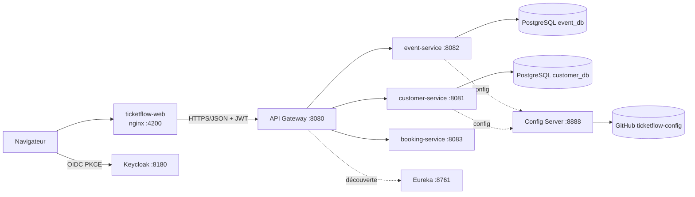

# TicketFlow – Partie A : catalogue et comptes

Cette partie couvre FR-001 à FR-006 et FR-022 du cahier des charges : catalogue d'événements, gestion des événements par les organisateurs, comptes clients, rôles et permissions, interface Angular accessible.

Services concernés : `event-service`, `customer-service`, Keycloak (sécurité), `ticketflow-web` (Angular). Le Gateway, Eureka et le Config Server sont partagés avec le reste du projet.

## 1. Architecture



| Composant | Rôle | Port |
|---|---|---|
| ticketflow-web | Interface Angular servie par nginx | 4200 |
| gateway-api | Point d'entrée, validation du JWT, CORS, routes explicites | 8080 |
| customer-service | Comptes et profils | 8081 |
| event-service | Catalogue et gestion des événements | 8082 |
| booking-service | Réservations (partie B) | 8083 |
| Keycloak | Identité, rôles, jetons | 8180 |
| Config Server | Configuration centralisée (dépôt GitHub `ticketflow-config`) | 8888 |
| Eureka | Découverte de services | 8761 |
| PostgreSQL | Une base par service : `event_db`, `customer_db` | 5432 |

Toute la configuration non secrète est dans le dépôt `ticketflow-config` : `application.yml` (commun), `<service>.yml`, et `<service>-docker.yml` pour l'exécution dans Docker. Aucun secret réel n'est versionné.

## 2. Sécurité

- Connexion par OIDC, flux Authorization Code avec PKCE (S256), client public `ticketflow-web`, realm `ticketflow`.
- Le jeton JWT est validé par le Gateway **et** par chaque service : le contrôle ne repose pas sur le seul Gateway ni sur Angular (FR-006).
- Les rôles du jeton (`realm_access.roles`) sont convertis en autorités `ROLE_*`.
- Rôle par défaut d'un utilisateur inscrit : `CLIENT` uniquement (groupe par défaut `clients`). Les rôles `ORGANIZER` et `ADMIN` ne sont jamais attribués par l'inscription.
- Identité issue du jeton : l'identifiant de l'organisateur (`organizerId`) et du client (`keycloakId`) vient du claim `sub`, jamais d'un paramètre fourni par l'appelant.
- Un organisateur ne voit et ne modifie que ses événements. Un événement d'un autre organisateur répond `404`, pour ne pas révéler son existence.
- Les endpoints `/actuator/health` et `/actuator/info` sont publics. Les autres endpoints d'administration exigent un jeton.

| Rôle | Droits |
|---|---|
| Visiteur (sans jeton) | Consulter le catalogue et les fiches d'événements publiés |
| CLIENT | Gérer son profil (`/me`), demander la fermeture de son compte |
| ORGANIZER | Créer, modifier, publier, clôturer, archiver ses événements |
| ADMIN | Lister et administrer les comptes clients |

Comptes de démonstration (fictifs, importés avec le realm) :

| Utilisateur | Mot de passe | Rôle |
|---|---|---|
| client1 | client123 | CLIENT |
| organizer1 | organizer123 | ORGANIZER |
| organizer2 | organizer223 | ORGANIZER |
| admin1 | admin123 | ADMIN |

## 3. API

Tous les appels passent par le Gateway : `http://localhost:8080`.

### event-service

| Méthode et chemin | Rôle | Description |
|---|---|---|
| `GET /api/events` | public | Événements publiés, avec filtres `q`, `city`, `category`, `dateFrom`, `dateTo`, `minPrice`, `maxPrice`, tri (`eventDate`, `price`, `title`), `direction`, `page`, `size` (taille plafonnée) |
| `GET /api/events/{id}` | public | Fiche d'un événement publié ; `404` pour un brouillon ou un événement inexistant |
| `POST /api/events` | ORGANIZER | Crée un événement (brouillon) rattaché à l'organisateur |
| `PUT /api/events/{id}` | ORGANIZER (propriétaire) | Modifie un événement ; la capacité d'un événement publié ne peut pas diminuer |
| `POST /api/events/{id}/publish` | ORGANIZER (propriétaire) | Publie un brouillon |
| `POST /api/events/{id}/close` | ORGANIZER (propriétaire) | Clôture un événement publié (il quitte le catalogue) |
| `POST /api/events/{id}/archive` | ORGANIZER (propriétaire) | Archive un brouillon ou un événement clôturé |
| `GET /api/events/manage` | ORGANIZER | Mes événements, tous statuts, paginé (`status` facultatif) |
| `GET /api/events/manage/{id}` | ORGANIZER (propriétaire) | Détail d'un de mes événements |

Codes d'erreur : `400` filtre ou donnée invalide, `401` jeton absent ou invalide, `403` rôle insuffisant, `404` introuvable ou non autorisé, `409` transition d'état interdite.

Compatibilité avec booking-service : `GET /api/events/{id}` reste public et renvoie `id`, `title`, `summary`, `eventDate`, `city`, `venue`, `category`, `price`, `capacity`, `status`. Le service de réservation l'appelle par OpenFeign.

### customer-service

| Méthode et chemin | Rôle | Description |
|---|---|---|
| `GET /api/customers/me` | CLIENT authentifié | Mon profil ; créé à la première connexion à partir du jeton |
| `PUT /api/customers/me` | CLIENT authentifié | Modifie `firstName`, `lastName`, `phone` (l'email n'est jamais modifiable) |
| `POST /api/customers/me/close` | CLIENT authentifié | Enregistre une demande de fermeture de compte |
| `GET /api/customers` | ADMIN | Liste des clients, avec `closureRequested` (demande de fermeture en attente) |
| `PUT /api/customers/{id}` | ADMIN | Modifie un client |
| `GET /api/customers/{id}` | ADMIN | Profil d'un client |
| `POST /api/customers` | ADMIN | Crée un client |
| `DELETE /api/customers/{id}` | ADMIN | Supprime un client |
**Traitement d'une demande de fermeture de compte.** Le client demande la fermeture depuis « Mon profil » (`POST /me/close`). Il n'existe pas d'écran d'administration dans Angular : l'administrateur traite la demande par l'API et la console Keycloak.

1. Lister les clients (`GET /api/customers`) et repérer ceux dont `closureRequested` vaut `true`.
2. Supprimer le profil (`DELETE /api/customers/{id}`).
3. Dans la console Keycloak (http://localhost:8180, realm `ticketflow`), ouvrir Users, puis désactiver ou supprimer l'utilisateur. Sans cette étape, le client pourrait se reconnecter et un nouveau profil serait recréé automatiquement.
## 4. Données

Chaque service possède sa base et ses migrations Flyway (`V1__…sql`). Aucune jointure entre bases de services.

**event_db – table `events`**

| Colonne | Type | Remarque |
|---|---|---|
| id | BIGINT, clé primaire | généré |
| title | VARCHAR(255) | obligatoire |
| summary | VARCHAR(2000) | |
| event_date | TIMESTAMP WITH TIME ZONE | obligatoire |
| city, venue, category | VARCHAR(255) | obligatoires |
| price | NUMERIC(10,2) | obligatoire, 0 pour gratuit |
| capacity | INTEGER | obligatoire |
| status | VARCHAR(20) | `DRAFT`, `PUBLISHED`, `CLOSED`, `ARCHIVED` |
| created_at | TIMESTAMP WITH TIME ZONE | obligatoire |
| organizer_id | VARCHAR(100) | `sub` du jeton Keycloak de l'organisateur |

Index : `(status, event_date)` pour le catalogue, `(organizer_id)` pour la gestion.

**customer_db – table `customers`**

| Colonne | Type | Remarque |
|---|---|---|
| id | BIGINT, clé primaire | généré |
| first_name, last_name, phone | VARCHAR(255) | |
| email | VARCHAR(255) | obligatoire, unique |
| keycloak_id | VARCHAR(255) | `sub` du jeton, unique |
| closure_requested | BOOLEAN | faux par défaut |
| created_at | TIMESTAMP WITH TIME ZONE | obligatoire |

Cycle de vie d'un événement :

| Action | Statut de départ | Statut d'arrivée |
|---|---|---|
| Publier | DRAFT | PUBLISHED |
| Clôturer | PUBLISHED | CLOSED |
| Archiver | DRAFT ou CLOSED | ARCHIVED |

Toute autre transition est refusée avec `409`.

## 5. Lancement

Prérequis : Docker Desktop, JDK 21 ou plus, IntelliJ. Mot de passe de démonstration de PostgreSQL : `ticketflow_dev` par défaut ; pour le changer, créer `infra/.env` à partir de `infra/.env.example` (ce fichier n'est pas versionné).

Ordre de démarrage :

1. Infrastructure (cmd, dossier `infra`) :
   ```
   docker compose up -d postgres keycloak
   ```
   Attendre environ 30 secondes. Console Keycloak : http://localhost:8180.
2. Dans IntelliJ : `ConfigServerApplication` (8888), puis `DiscoveryServeurApplication` (8761).
3. Services et interface (cmd, dossier `infra`) :
   ```
   docker compose up -d --build event-service customer-service web
   ```
4. Dans IntelliJ : `GatewayApiApplication` (8080).
5. Ouvrir http://localhost:4200.

Si la base est vide, charger des événements de démonstration (Git Bash, racine du projet) : `bash scripts/seed-events.sh`.

Tests automatiques (cmd, racine du projet, avec un JDK 21 ou plus dans `JAVA_HOME`) :

```
mvnw.cmd -B -ntp verify
```

## 6. Scénario de démonstration (5 minutes)

1. **Visiteur** : ouvrir le catalogue, filtrer par ville, trier par prix, ouvrir une fiche, recharger la page.
2. **Inscription** : « S'inscrire », créer un compte ; ouvrir « Mon profil », modifier le prénom, constater que l'email est verrouillé.
3. **Mauvaise permission** : avec ce compte client, ouvrir `/organizer` : page « Accès refusé ».
4. **Organisateur** : se connecter avec `organizer1`, « Mes événements » puis « Créer un événement ». Le brouillon n'apparaît pas dans le catalogue public.
5. **Publication** : publier le brouillon ; il apparaît dans le catalogue. Le clôturer ; il disparaît.
6. **Isolation** (Git Bash) :
   ```bash
   G=http://localhost:8080
   token() { curl -s -X POST http://localhost:8180/realms/ticketflow/protocol/openid-connect/token -d grant_type=password -d client_id=ticketflow-web -d username=$1 -d password=$2 | sed -E 's/.*"access_token":"([^"]+)".*/\1/'; }
   ORG2=$(token organizer2 organizer223)
   curl -s -H "Authorization: Bearer $ORG2" "$G/api/events/manage"        # aucun événement
   curl -s -o /dev/null -w "%{http_code}\n" -X POST -H "Authorization: Bearer $ORG2" $G/api/events/1/close   # 404
   curl -s -o /dev/null -w "%{http_code}\n" $G/api/events/manage          # 401
   ```

## 7. Accessibilité et interface (FR-022)

- Page en français (`lang="fr"`), lien « Aller au contenu », contour de focus visible, navigation complète au clavier.
- Tous les champs ont un `label` ; les messages d'erreur utilisent `role="alert"`, les états de chargement et de résultat `aria-live`.
- Après une action qui fait disparaître un bouton (fermeture de compte) ou une erreur de formulaire, le focus est replacé sur l'élément pertinent.
- Tableau de gestion des événements : en-têtes `scope`, zone défilante atteignable au clavier, boutons nommés avec le titre de l'événement.
- Affichage adapté au mobile et au bureau, sans défilement horizontal de la page.
- Les erreurs `401`, `403`, `404` et d'indisponibilité du serveur ont chacune un message clair.

## 8. Captures à ajouter

Placer les images dans `docs/img/` et les référencer ici :

- catalogue avec filtres ;
- fiche d'un événement ;
- connexion Keycloak ;
- profil client ;
- page « Accès refusé » ;
- console organisateur (liste et formulaire) ;
- résultat du `mvnw.cmd verify` (`BUILD SUCCESS`) ;
- `docker ps` avec les conteneurs en marche.

## 9. Limites connues

- Config Server, Eureka et Gateway se lancent depuis IntelliJ ; ils ne sont pas encore dans Docker Compose. Les conteneurs les joignent par `host.docker.internal`, et s'enregistrent dans Eureka avec le nom d'hôte `localhost` pour rester joignables depuis le Gateway lancé sur la machine.
- Les scripts de démonstration utilisent le flux « mot de passe » de Keycloak (activé sur le client de démonstration). À désactiver hors démonstration.
- Keycloak tourne en mode développement (HTTP, base interne) : ne pas utiliser tel quel en production.
- La demande de fermeture de compte est traitée à la main par un administrateur (API et console Keycloak) ; il n'y a pas d'écran d'administration dans Angular.
- Catégories de billets et disponibilité (FR-003, FR-001 en partie) : dépendent du service de réservation (partie B), non réalisées ici.
- Les appels OpenFeign de booking-service vers event-service passent sans jeton, car `GET /api/events/{id}` est public ; la méthode d'authentification des appels entre services reste à décider avec la partie B.
- Description OpenAPI des API : non réalisée.
